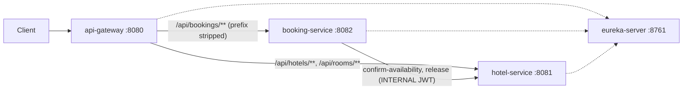

# Платформа бронирования отелей (Hotel Booking Platform)

Система бронирования отелей из четырёх самостоятельных Spring Boot приложений (Java 21, Spring Boot 3.5, Spring Cloud 2025.0).
У каждого сервиса своя in-memory база H2, данные сбрасываются при перезапуске.

| Компонент | Порт | Назначение |
|---|---|---|
| `eureka-server` | 8761 | реестр сервисов (Service Discovery) |
| `api-gateway` | 8080 | единая точка входа: маршрутизация, проверка JWT, `X-Correlation-Id`, общий Swagger UI |
| `hotel-service` | 8081 | отели и номера (CRUD), рекомендации по загрузке, статистика, блокировка слотов для бронирований |
| `booking-service` | 8082 | регистрация и вход (JWT), бронирования, администрирование пользователей |



Каждый сервис сам проверяет JWT (Resource Server). Gateway дополнительно отсекает запросы без валидного токена
и не публикует внутренние эндпойнты.

---

## 1. Как пользоваться системой

### Запуск

Нужен только Docker.

```bash
docker compose up --build
```

Первая сборка занимает несколько минут (скачиваются зависимости Maven). После старта (около 40 секунд, пока сервисы
зарегистрируются в Eureka):

| Что | Адрес |
|---|---|
| API (единственная точка входа для клиентов) | http://localhost:8080 |
| Swagger UI обоих сервисов | http://localhost:8080/swagger-ui.html |
| Eureka dashboard | http://localhost:8761 |
| Сервисы напрямую (для отладки) | hotel-service `:8081`, booking-service `:8082` |

Остановка: `docker compose down`.

<details>
<summary>Запуск без Docker</summary>

Нужны JDK 21 и Maven 3.9+. Сервисы запускаются в отдельных терминалах, Eureka первой:

```bash
mvn -pl eureka-server spring-boot:run
mvn -pl hotel-service spring-boot:run
mvn -pl booking-service spring-boot:run
mvn -pl api-gateway spring-boot:run
```

Адреса по умолчанию указывают на `localhost`, поэтому дополнительная настройка не нужна.
</details>

### Учётные записи и роли

- При старте Booking Service создаёт администратора: логин `admin`, пароль `admin12345` (меняется переменными `ADMIN_USERNAME` и `ADMIN_PASSWORD`).
- Самостоятельная регистрация (`POST /user/register`) всегда создаёт роль `USER`. Роль `ADMIN` может выдать только администратор.
- Токен действует 1 час. Его нужно передавать в заголовке `Authorization: Bearer <token>`.
- Hotel Service при старте заполняется демо-данными: 3 отеля и 10 номеров.

| Роль | Что доступно |
|---|---|
| `USER` | просмотр отелей и номеров, создание, просмотр и отмена своих бронирований |
| `ADMIN` | всё, что `USER`, плюс CRUD отелей, номеров и пользователей, статистика загруженности |
| `INTERNAL` | служебная роль для вызовов Booking Service в Hotel Service (`confirm-availability`, `release`) |

### Пошаговый сценарий (curl)

Все запросы идут через Gateway. Для разбора токена используется `jq` (необязательно, токен можно скопировать вручную).
Даты бронирования должны быть в будущем, интервал полуоткрытый: `[startDate, endDate)`, день выезда свободен.

```bash
GW=http://localhost:8080

# 1. Администратор входит и получает токен
ADMIN=$(curl -s -X POST $GW/api/bookings/user/auth -H 'Content-Type: application/json' \
  -d '{"username":"admin","password":"admin12345"}' | jq -r .accessToken)

# 2. Пользователь регистрируется (сразу получает токен)
USER=$(curl -s -X POST $GW/api/bookings/user/register -H 'Content-Type: application/json' \
  -d '{"username":"alice","password":"secret123"}' | jq -r .accessToken)

# 3. Администратор добавляет отель и номер
curl -s -X POST $GW/api/hotels -H "Authorization: Bearer $ADMIN" -H 'Content-Type: application/json' \
  -d '{"name":"Plaza","address":"Moscow, Tverskaya 1"}'
curl -s -X POST $GW/api/rooms -H "Authorization: Bearer $ADMIN" -H 'Content-Type: application/json' \
  -d '{"hotelId":4,"number":"501"}'

# 4. Пользователь смотрит отели и рекомендованные номера (самые «незагруженные» первыми)
curl -s $GW/api/hotels -H "Authorization: Bearer $USER"
curl -s "$GW/api/rooms/recommend?startDate=2030-01-10&endDate=2030-01-15" -H "Authorization: Bearer $USER"

# 5. Бронирование выбранного номера
curl -s -X POST $GW/api/bookings/booking -H "Authorization: Bearer $USER" -H 'Content-Type: application/json' \
  -d '{"roomId":1,"startDate":"2030-01-10","endDate":"2030-01-15","requestId":"my-first-booking"}'

# 6. Бронирование с автоподбором номера (roomId игнорируется)
curl -s -X POST $GW/api/bookings/booking -H "Authorization: Bearer $USER" -H 'Content-Type: application/json' \
  -d '{"autoSelect":true,"startDate":"2030-01-10","endDate":"2030-01-15"}'

# 7. История бронирований, одно бронирование, отмена
curl -s $GW/api/bookings/bookings -H "Authorization: Bearer $USER"
curl -s $GW/api/bookings/booking/1 -H "Authorization: Bearer $USER"
curl -s -X DELETE $GW/api/bookings/booking/1 -H "Authorization: Bearer $USER"

# 8. Администратор смотрит статистику загруженности номеров
curl -s $GW/api/rooms/stats -H "Authorization: Bearer $ADMIN"
```

Id отеля (`4`) и номера (`1`) в примере зависят от текущего состояния базы: смотрите ответы предыдущих запросов.

### Swagger UI

1. Откройте http://localhost:8080/swagger-ui.html и выберите документ в выпадающем списке: «Сервис бронирований» или «Сервис управления отелями».
2. Получите токен через `POST /user/auth` (или `/user/register`) и скопируйте `accessToken`.
3. Нажмите **Authorize** и вставьте токен без слова `Bearer`.

В документе Booking Service по умолчанию выбран сервер `/api/bookings` (через Gateway). При открытии Swagger напрямую на
порту 8082 выберите сервер `/` (Direct).

### Что происходит при бронировании

1. Booking Service сохраняет бронирование в статусе `PENDING` (отдельная локальная транзакция).
2. Он вызывает `POST /api/rooms/{id}/confirm-availability` в Hotel Service. Hotel временно блокирует номер на период.
   У вызова таймаут 2 секунды и 3 попытки с растущей паузой (200 мс, 400 мс).
3. Успех: бронирование становится `CONFIRMED`.
4. Ошибка или таймаут после всех попыток: Booking вызывает `POST /api/rooms/{id}/release` (компенсация), бронирование
   становится `CANCELLED`, клиент получает `503`.
5. Если Hotel ответил, что номер занят, бронирование `CANCELLED`, клиент получает `409` (повторов и `release` нет).

Коды ответа `POST /booking`:

| Код | Когда |
|---|---|
| `201` | бронирование создано и подтверждено |
| `200` | запрос с таким `requestId` уже обрабатывался: возвращается сохранённое бронирование (статус может быть и `CANCELLED`) |
| `400` | неверные даты (в прошлом, `endDate` не позже `startDate`) или не указан `roomId` без `autoSelect` |
| `404` | номер не существует |
| `409` | номер занят на эти даты, в том числе проигранная гонка при одновременных запросах |
| `503` | Hotel Service недоступен или не ответил вовремя: бронирование отменено, блокировка снята |

Полезно знать:

- **Идемпотентность.** `requestId` в теле запроса работает как ключ: повторная отправка того же запроса (после таймаута
  клиента, при ретраях) не создаёт дубликат. Если `requestId` не указан, он генерируется. После отказа (`503`, `409`)
  новую попытку нужно делать с **новым** `requestId`, иначе вернётся сохранённое отменённое бронирование.
- **Автоподбор.** Booking запрашивает у Hotel свободные номера в порядке возрастания `times_booked` (при равенстве по `id`)
  и берёт первый. Если он занят, пробует следующий.
- **Сквозные идентификаторы.** Все шаги одного бронирования логируются с `bookingId`
  (`bookingId=7 статус PENDING -> CONFIRMED`), Gateway добавляет `X-Correlation-Id` (возвращается в ответе).
  Журнал: `docker compose logs booking-service | grep "bookingId=7 "`.
- **Восстановление.** Фоновая задача раз в 30 секунд отменяет бронирования, застрявшие в `PENDING` дольше 2 минут,
  и повторяет компенсацию `release`, если она не дошла до Hotel Service.
- **Ошибки и логи на русском языке.** Ошибки возвращаются в формате RFC 7807 (`application/problem+json`): поля `title` и
  `detail` на русском (в том числе для `401` и `403`, ошибок Spring MVC и сообщений валидации полей, например
  `"errors": {"name": "не должно быть пустым"}`). В ответах о неудачном бронировании есть поля `bookingId` и
  `bookingStatus`. Ошибки самого шлюза (нет маршрута, сервис недоступен) приходят в стандартном JSON Spring Boot с
  русским полем `error`. Сообщения в логах тоже русские, но имена полей и статусов (`bookingId`, `requestId`,
  `PENDING`, `CONFIRMED`, `CANCELLED`) остаются прежними, поэтому по ним удобно искать.

---

## 2. Эндпойнты

Таблицы описывают пути **через Gateway**. У Booking Service сервис-путь получается отбрасыванием префикса `/api/bookings`
(`/api/bookings/booking` → `/booking`). Все эндпойнты, кроме отмеченных «публичный», требуют заголовок
`Authorization: Bearer <token>`. Без токена ответ `401`, с токеном недостаточной роли `403`.

### Booking Service (`/api/bookings/**`)

| Метод и путь | Роль | Описание |
|---|---|---|
| `POST /api/bookings/user/register` | публичный | регистрация (роль `USER`), в ответе JWT |
| `POST /api/bookings/user/auth` | публичный | вход, в ответе JWT |
| `POST /api/bookings/user` | ADMIN | создать пользователя с любой ролью |
| `PATCH /api/bookings/user` | ADMIN | изменить пользователя; тело `{id, username?, password?, role?}`, меняются только переданные поля |
| `DELETE /api/bookings/user?id={id}` | ADMIN | удалить пользователя (`409`, если есть активные бронирования) |
| `GET /api/bookings/user` | ADMIN | список пользователей |
| `GET /api/bookings/user/{id}` | ADMIN | пользователь по id |
| `POST /api/bookings/booking` | USER, ADMIN | создать бронирование; тело `{roomId, startDate, endDate, autoSelect, requestId?}` |
| `GET /api/bookings/bookings` | USER, ADMIN | история бронирований текущего пользователя, новые первыми |
| `GET /api/bookings/booking/{id}` | USER, ADMIN | бронирование по id (свои; администратор любое) |
| `DELETE /api/bookings/booking/{id}` | USER, ADMIN | отменить бронирование (идемпотентно); подтверждённое сначала освобождает номер в Hotel |

Примеры тел:

```jsonc
// POST /user/register, POST /user/auth
{"username": "alice", "password": "secret123"}          // username 3-64, password 6-128 символов

// ответ register / auth
{"accessToken": "...", "tokenType": "Bearer", "expiresIn": 3600, "userId": 2, "username": "alice", "role": "USER"}

// POST /booking
{"roomId": 1, "startDate": "2030-01-10", "endDate": "2030-01-15", "autoSelect": false, "requestId": "any-unique-key"}

// ответ booking
{"id": 1, "userId": 2, "roomId": 1, "startDate": "2030-01-10", "endDate": "2030-01-15",
 "status": "CONFIRMED", "createdAt": "2030-01-01T10:00:00Z", "requestId": "any-unique-key", "failureReason": null}
```

### Hotel Management Service (`/api/hotels/**`, `/api/rooms/**`)

| Метод и путь | Роль | Описание |
|---|---|---|
| `POST /api/hotels` | ADMIN | добавить отель `{name, address}` |
| `GET /api/hotels` | USER, ADMIN | список отелей |
| `GET /api/hotels/{id}` | USER, ADMIN | отель по id |
| `PUT /api/hotels/{id}` | ADMIN | изменить отель |
| `DELETE /api/hotels/{id}` | ADMIN | удалить отель (`409`, если в нём есть номера) |
| `POST /api/rooms` | ADMIN | добавить номер в отель `{hotelId, number, available?}`; `409` при дубле номера в отеле |
| `GET /api/rooms` | USER, ADMIN | свободные номера (`available=true`), без особой сортировки; необязательные `startDate` и `endDate` исключают номера, заблокированные на эти даты |
| `GET /api/rooms/recommend` | USER, ADMIN | те же номера, отсортированные по возрастанию `times_booked`, при равенстве по `id` (параметры дат те же) |
| `GET /api/rooms/stats` | ADMIN | статистика загруженности: по каждому отелю число номеров, сумма и среднее `times_booked`, разбивка по номерам |
| `GET /api/rooms/{id}` | USER, ADMIN | номер по id |
| `PUT /api/rooms/{id}` | ADMIN | изменить номер (в том числе `available`: ремонт, вывод из эксплуатации) |
| `DELETE /api/rooms/{id}` | ADMIN | удалить номер (`409`, если есть активные резервы) |

`available` отражает операционную доступность номера (ремонт и т.п.). Занятость на даты определяется блокировками слотов
и бронированиями.

### Внутренние эндпойнты Hotel Service

Вызываются только Booking Service с короткоживущим служебным JWT (роль `INTERNAL`). **Через Gateway не публикуются** (ответ `404`),
напрямую на порту 8081 доступны только с токеном `INTERNAL` (токен `ADMIN` получит `403`).

| Метод и путь | Описание |
|---|---|
| `POST /api/rooms/{id}/confirm-availability` | подтвердить доступность и временно заблокировать номер на `[startDate, endDate)`; тело `{requestId, bookingId, startDate, endDate}`; `409`, если номер занят; идемпотентно по `requestId` |
| `POST /api/rooms/{id}/release` | компенсация: снять блокировку, созданную с тем же `requestId`; тело `{requestId, bookingId}`; идемпотентно (если блокировки не было, записывается «надгробие», и запоздавший `confirm` с тем же `requestId` получит `409`) |

### Служебные

| Путь | Описание |
|---|---|
| `GET /swagger-ui.html` | Swagger UI (на Gateway объединяет оба сервиса) |
| `GET /v3/api-docs` | OpenAPI JSON сервиса (у Gateway документы сервисов: `/docs/booking/v3/api-docs`, `/docs/hotel/v3/api-docs`) |
| `GET /actuator/health` | состояние сервиса |

---

## 3. Как протестировать

### Автоматические тесты (JUnit 5 + MockMvc)

Поднимать Eureka и остальные сервисы для тестов не нужно: Hotel Service в тестах Booking Service подменяется WireMock,
а базы in-memory.

**Через Docker** (ничего ставить не нужно, на Linux и macOS одинаково):

```bash
docker run --rm -v "$PWD":/workspace -v m2cache:/root/.m2 -w /workspace \
  maven:3.9-eclipse-temurin-21 mvn -B verify
```

**Локально** (JDK 21 и Maven 3.9+):

```bash
mvn verify                                   # все модули
mvn -pl booking-service -am verify           # один модуль (и его родительский pom)
mvn -pl booking-service -am test -Dtest=BookingSagaTest -Dsurefire.failIfNoSpecifiedTests=false   # один класс
```

Ожидаемый результат: `BUILD SUCCESS`, 86 тестов (Eureka 2, Gateway 10, Hotel 36, Booking 38).

| Модуль | Тестовые классы | Что проверяют |
|---|---|---|
| `hotel-service` | `HotelAndRoomCrudSecurityTest` | CRUD отелей и номеров, роли (`403`/`401`), валидация, просроченный и чужой токен, тексты ошибок на русском языке |
| | `RoomSearchAndStatsTest` | порядок `recommend` по `times_booked` и `id`, фильтр по датам, статистика только для ADMIN |
| | `RoomAvailabilityTest` | `confirm-availability` и `release`: успех, пересечение дат (`409`), смежные периоды, повторная доставка, «надгробие», доступ только для `INTERNAL` |
| | `RoomAvailabilityConcurrencyTest` | 8 потоков на один номер: ровно один победитель, остальные `409`, один слот |
| | `OpenApiDocumentationTest` | OpenAPI-документ и Swagger UI доступны без токена |
| `booking-service` | `BookingSagaTest` | **успех** (`PENDING` → `CONFIRMED`); **ошибка удалённого сервиса** (ретраи исчерпаны, компенсация, `CANCELLED`); **тайм-аут**; сбой на первой попытке и успех на второй; `409` без `release`; **повторная доставка запроса** (одна запись, один вызов Hotel); автоподбор и переход к следующему номеру; отмена; фоновое восстановление; проверка логов (переходы состояний и результат компенсации) |
| | `BookingConcurrencyTest` | одновременные брони одного номера на пересекающиеся даты: один `201`, остальные `409`, без дублей; одновременная повторная отправка одного запроса |
| | `UserAuthAndAdminTest` | регистрация, вход, срок токена 1 час, BCrypt, администрирование пользователей, запрет доступа по ролям, подделанный токен, русские сообщения валидации |
| | `OpenApiDocumentationTest` | OpenAPI-документ и Swagger UI |
| `api-gateway` | `ApiGatewayRoutingTest` | rewrite путей, пробрасывание JWT, публичные регистрация и вход, `401` без токена, скрытые внутренние эндпойнты (`404`), `X-Correlation-Id`, русские тексты ошибок шлюза |
| `eureka-server` | `EurekaServerApplicationTests` | запуск реестра |

### Ручная проверка на запущенной системе

1. Запустите `docker compose up --build` и пройдите сценарий из раздела 1.
2. Проверьте компенсацию: остановите Hotel Service и создайте бронирование.

   ```bash
   docker compose stop hotel-service
   curl -s -X POST $GW/api/bookings/booking -H "Authorization: Bearer $USER" -H 'Content-Type: application/json' \
     -d '{"roomId":1,"startDate":"2030-02-10","endDate":"2030-02-15","requestId":"down-1"}'
   ```

   Примерно через 7 секунд придёт `503` с `"bookingStatus":"CANCELLED"`. В логах (`docker compose logs booking-service | grep "bookingId="`)
   видны три попытки `confirm-availability`, попытки `release` и переход `PENDING -> CANCELLED`.
3. Верните сервис: `docker compose start hotel-service`. Если `release` не дошёл, в течение 30 секунд фоновая задача
   доставит его (в логе `отложенная компенсация завершена`). После этого новая попытка с новым `requestId` проходит.
4. Проверьте ролевую модель: запрос с токеном `USER` на `POST /api/hotels` вернёт `403`, без токена `401`,
   `POST /api/rooms/1/release` через Gateway вернёт `404`.

---

## Конфигурация

| Переменная | Значение по умолчанию | Назначение |
|---|---|---|
| `JWT_SECRET` | dev-значение (не короче 32 байт) | общий секрет подписи JWT (HS256), одинаков во всех сервисах; **в любой реальной среде задайте свой** |
| `ADMIN_USERNAME`, `ADMIN_PASSWORD` | `admin` / `admin12345` | администратор, создаваемый Booking Service при старте |
| `EUREKA_URL` | `http://localhost:8761/eureka` | адрес Eureka (в compose `http://eureka-server:8761/eureka`) |
| `SERVER_PORT` | 8080 / 8081 / 8082 / 8761 | порт сервиса |

Тайм-ауты и ретраи вызовов Hotel Service настраиваются в `booking-service/src/main/resources/application.yml`
(`hotel.client.*`: `connect-timeout`, `read-timeout`, `max-attempts`, `initial-backoff`, `backoff-multiplier`, `max-backoff`),
фоновое восстановление в `booking.reaper.*`.

## Структура проекта

```
pom.xml                  родительский pom (Spring Boot 3.5.x, BOM Spring Cloud)
docker-compose.yml       запуск всей системы
eureka-server/           реестр сервисов
api-gateway/             Spring Cloud Gateway (WebFlux)
hotel-service/           entity, repository, service, controller, security, mapper (MapStruct), dto
booking-service/         то же + client (вызовы Hotel с ретраями), saga, фоновое восстановление
```

В каждом сервисе есть `Dockerfile` (многоэтапная сборка), `application.yml` и тесты в `src/test`.
